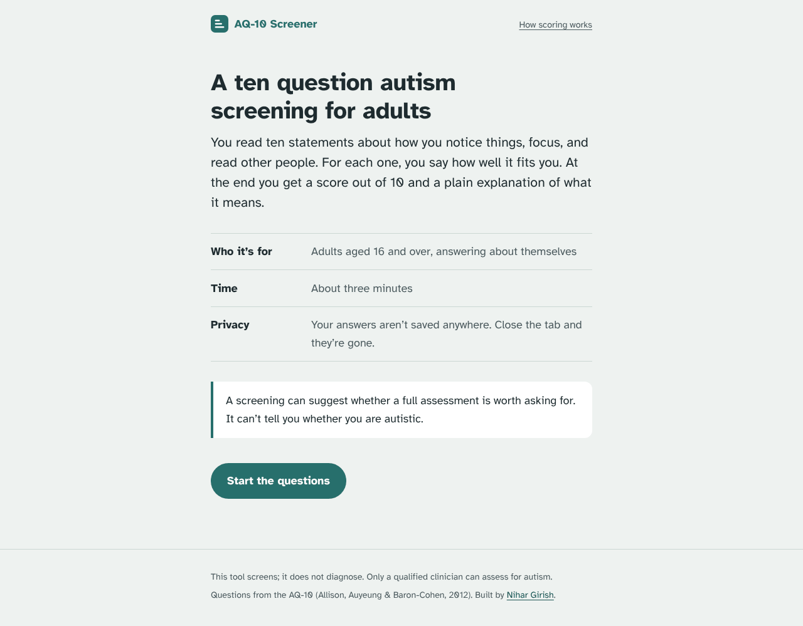
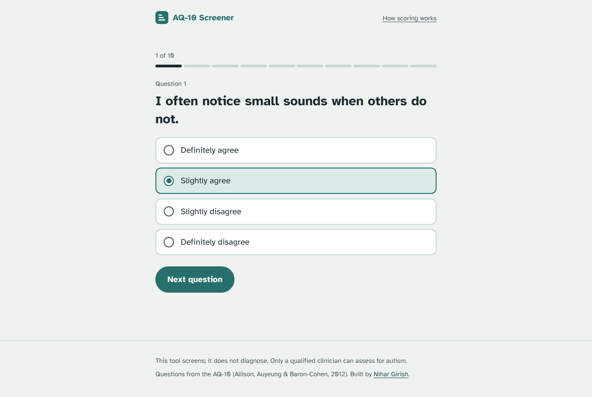
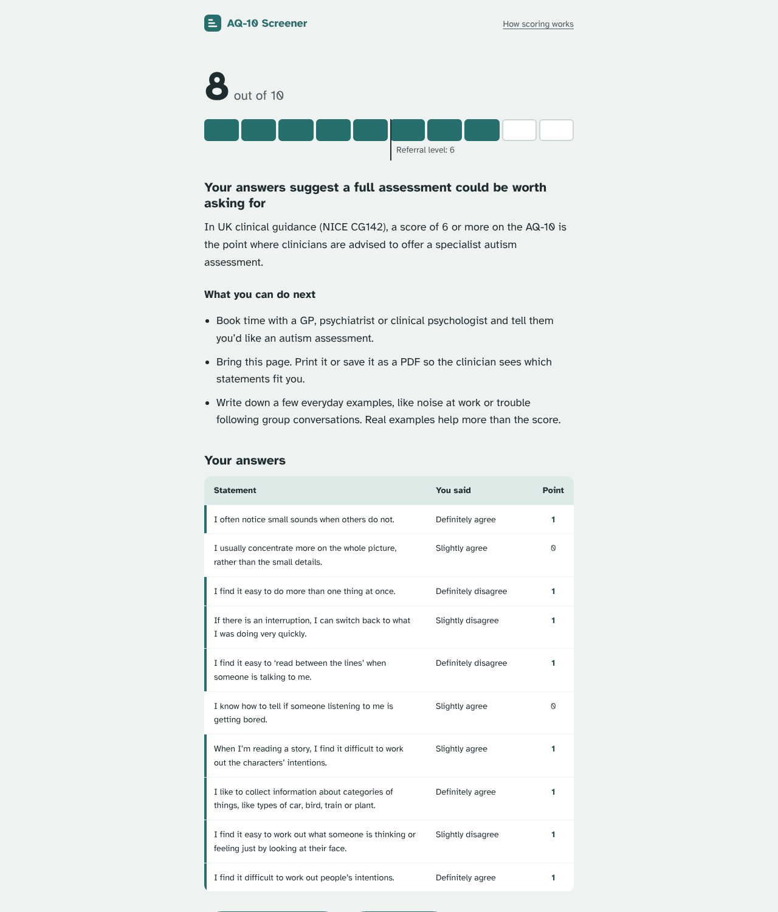
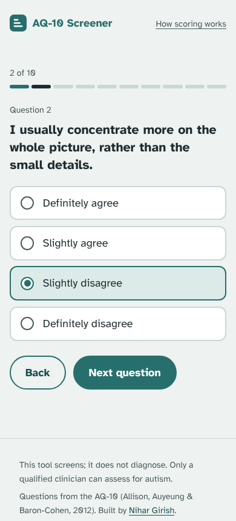

# AQ-10 Screener

A Flask app for the AQ-10, the ten question autism screening questionnaire for adults. You answer one statement at a time, and the app gives you a score out of 10 with a plain explanation of what it means.

It screens. It does not diagnose.

## How it works

You start on a short intro that tells you who the questionnaire is for, how long it takes, and that nothing you answer gets saved.



Each statement gets its own screen with four answers, from "Definitely agree" to "Definitely disagree". The bar at the top shows how far you are. You can go back and change an answer at any point.



The result shows your score as ten cells, one per statement, with a marker at 6. NICE guidance (CG142) tells clinicians to offer a specialist assessment at 6 or above. Under that you see what the score means, what to do next, and a table of every answer and whether it scored a point. Print it or save it as a PDF to take to a doctor.



On a phone the answers turn into large tap targets, and the keyboard works too: arrow keys pick an answer and Enter moves on.



## Scoring

Each statement scores one point at most. Agreeing scores the point on four statements (1, 7, 8, 10) and disagreeing scores it on the other six. "Slightly" and "definitely" count the same. The app uses the published items and scoring from Allison, Auyeung and Baron-Cohen (2012), and the "How scoring works" page lists the key for every statement.

## About the model

The UCI Autism Screening Adult dataset labels a row positive when its AQ-10 total is above 6. A model trained on the ten answers relearns that sum, so its near perfect accuracy tells you nothing a calculator couldn't. The app scores the questionnaire directly for that reason.

`scripts/train_model.py` runs the comparison. It downloads UCI dataset 426, prints the plain sum rule next to logistic regression and a random forest under 5-fold cross validation, and saves the logistic regression model. If that model file exists, the result page shows its probability as a cross check.

## Project layout

```
app/
  __init__.py       Flask app factory and routes
  aq10.py           Questionnaire items, answer scale, scoring
  model.py          Optional loader for a trained model
  templates/        Jinja templates
  static/           CSS, JS, self hosted Atkinson Hyperlegible font
scripts/
  train_model.py    Downloads UCI dataset 426, evaluates models, saves one
tests/
  test_app.py       Scoring and route tests
docs/screenshots/   Images used in this README
wsgi.py             Entry point for gunicorn and local runs
```

## Run it locally

```bash
python -m venv .venv
source .venv/bin/activate        # Windows: .venv\Scripts\activate
pip install -r requirements-dev.txt

python wsgi.py                   # http://localhost:5000
pytest                           # 18 tests
```

To train the optional model:

```bash
python scripts/train_model.py              # fetches the UCI data
python scripts/train_model.py path/to.csv  # or point it at a local CSV or ARFF file
```

The script writes `models/aq10_model.joblib` and `models/metrics.json`.

## Deploy

The `Procfile` runs `gunicorn wsgi:app`, so Render, Railway and Heroku pick it up as is. You don't need any environment variables.

## Design notes

Some people who take this screening find busy, bright or moving pages hard to use, so I kept the interface calm:

- One typeface, Atkinson Hyperlegible, which the Braille Institute designed for low vision readers. The app serves it from its own static folder, so it makes no third party requests.
- A muted grey green background and one teal for actions. Nothing animates.
- With JavaScript off, the form still works and shows all ten questions on one page.
- The server renders the result from the form post and never stores it.

## Sources

- Allison C, Auyeung B, Baron-Cohen S (2012). Toward brief "red flags" for autism screening. *Journal of the American Academy of Child and Adolescent Psychiatry*, 51(2), 202 to 212.
- NICE guideline CG142: Autism spectrum disorder in adults: diagnosis and management.
- Thabtah F. Autism Screening Adult dataset, UCI Machine Learning Repository, id 426.
